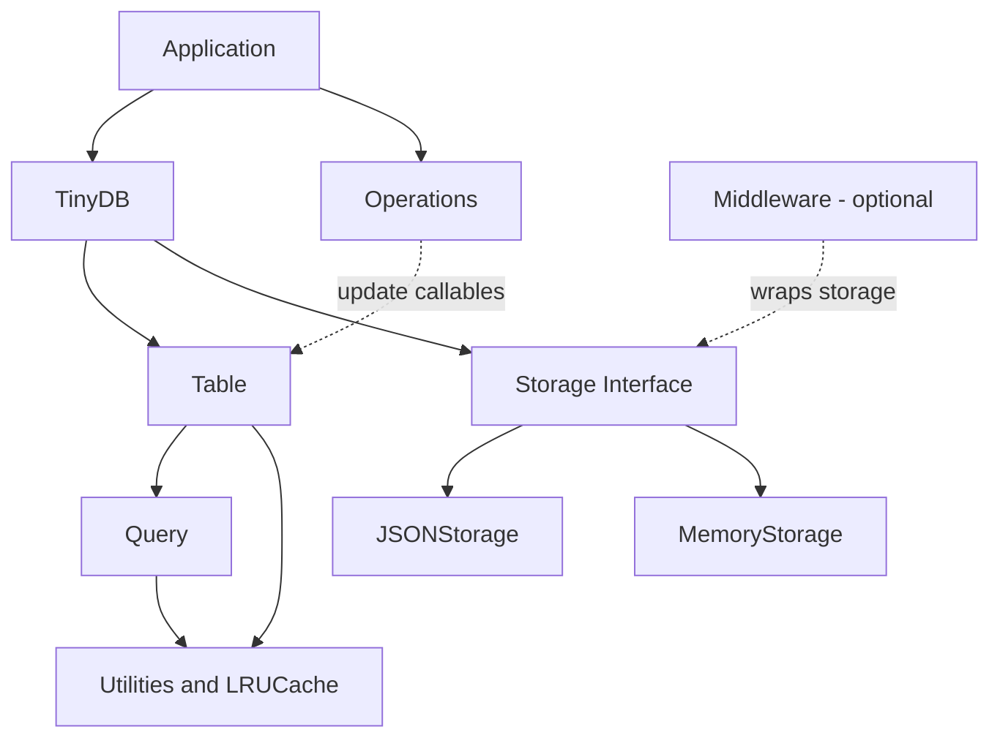

# TinyDB Architecture

## 1. Architecture Overview

TinyDB is a lightweight document database. Its architecture separates database coordination, table operations, query evaluation, storage and supporting functionality into individual components.

### Main Components

**1. TinyDB (`tinydb/database.py`)**

TinyDB is the main entry point to the database. It initializes the configured storage implementation, maintains references to tables and provides access to them.

- Uses `JSONStorage` as its default storage class.
- Accepts a configurable storage class through its constructor.
- Creates and manages `Table` instances.

**2. Table (`tinydb/table.py`)**

Table manages documents and provides the primary data operations.

- Supports inserting, searching, updating and removing documents.
- Uses storage to read and write table data.
- Evaluates queries when searching for matching documents.
- Maintains an LRU query cache to optimize repeated searches.

**3. Storage (`tinydb/storages.py`)**

Storage is the abstract interface responsible for persistence.

- Defines abstract `read()` and `write()` methods.
- `JSONStorage` persists data using JSON files.
- `MemoryStorage` keeps data in memory.

**4. Middleware (`tinydb/middlewares.py`)**

Middleware wraps a storage implementation and extends its behaviour without directly modifying the database or concrete storage classes.

- Provides a base `Middleware` class.
- Initializes the underlying storage.
- Forwards unhandled attributes to the wrapped storage.
- `CachingMiddleware` buffers writes and flushes them to the underlying storage.

**5. Query (`tinydb/queries.py`)**

The query component provides the interface and logic for expressing conditions used to search documents.

- Provides query objects and the `Query` interface.
- Supports logical combinations such as AND, OR and NOT.
- Provides query operations such as `one_of()` and `map()`.
- Uses `freeze()` from the utilities module when constructing query identity.

**6. Operations (`tinydb/operations.py`)**

This module provides reusable document transformation functions.

- Provides operations such as `set`, `add`, `subtract`, `increment` and `decrement`.
- These functions produce callables that can be supplied to table update operations.

**7. Utilities (`tinydb/utils.py`)**

The utilities module provides supporting functionality used by other components.

- `LRUCache` provides least-recently-used cache behaviour.
- `FrozenDict` and `freeze()` provide immutable representations used in query-related operations.

### Component Interaction Diagram

The application interacts with TinyDB and its tables. TinyDB initializes the configured storage, and tables use that storage for persistence. Tables evaluate query objects and use the query cache to optimize repeated searches. Operations provide reusable callables that can be passed to table update methods. Middleware can be configured around a storage implementation to add behaviour such as write caching.

---

## 2. Architecture Decision Records (ADRs)

### ADR-001: Abstract Storage Interface

**Context**

The database needs to support different persistence mechanisms. Placing file-specific or memory-specific persistence logic directly inside `TinyDB` or `Table` would couple database operations to a particular storage implementation.

**Decision**

Use an abstract `Storage` class that defines the persistence contract through `read()` and `write()`. Concrete storage implementations, such as `JSONStorage` and `MemoryStorage`, implement this contract. `TinyDB` initializes the configured storage implementation and makes it available to tables.

**Alternatives Considered**

- Implement persistence directly inside `TinyDB`.
- Implement separate persistence logic inside each table.
- Use concrete storage classes without a common abstract interface.

**Consequences**

- Different storage implementations can be used through a common interface.
- Database and table operations do not need to depend on the internal persistence mechanism.
- New storage implementations must satisfy the abstract storage contract.

**Evidence:** `tinydb/storages.py:36–76`; `tinydb/database.py:92–98`; `tinydb/table.py:94–108`.

**Status:** Verified

### ADR-002: Middleware as a Storage Extension Mechanism

**Context**

Additional storage-related behaviour, such as caching or logging, should be possible without adding that behaviour directly to every concrete storage implementation or to the core database class.

**Decision**

Use middleware to wrap a storage implementation and intercept storage operations. The base `Middleware` class initializes the underlying storage and forwards unhandled attributes to it. `CachingMiddleware` demonstrates this approach by buffering writes and flushing them to the underlying storage.

**Alternatives Considered**

- Add caching and other additional behaviour directly to `JSONStorage` and `MemoryStorage`.
- Implement storage-related extensions directly inside `TinyDB`.
- Duplicate additional behaviour across individual storage implementations.

**Consequences**

- Additional behaviour can be separated from concrete storage implementations.
- Middleware can intercept read and write operations.
- Middleware implementations must correctly initialize and delegate to the underlying storage.
- Buffered writes introduce a lifecycle consideration: pending data must be flushed when required.

**Evidence:** `tinydb/middlewares.py:10–23`; `tinydb/middlewares.py:63–73`; `tinydb/middlewares.py:76–142`.

**Status:** Verified

### ADR-003: Query Result Caching at the Table Level

**Context**

Repeated searches using the same query can require evaluating the same conditions against table documents multiple times. This can add unnecessary work when the same queries are executed repeatedly.

**Decision**

Maintain an LRU query cache inside each `Table`. Cacheable queries can reuse previously computed search results. The cache is cleared when table data is modified to avoid returning results based on outdated data.

**Alternatives Considered**

- Re-evaluate every query without caching.
- Maintain a single shared query cache outside individual tables.
- Retain cached results after table modifications and manage invalidation separately.

**Consequences**

- Repeated cacheable searches can reuse previous results.
- The cache has a configurable capacity and uses LRU behaviour.
- Cache invalidation is required when table data changes.
- Only queries considered cacheable should be stored in the query cache.

**Evidence:** `tinydb/table.py:41–50`; `tinydb/table.py:87–108`; `tinydb/table.py:249–295`; `tinydb/table.py:850–854`.

**Status:** Verified

---

## 3. Developer Constraints

The following constraints describe architectural rules that developers should preserve when extending or modifying TinyDB.

| ID | Constraint | Where the rule can be seen |
|---|---|---|
| CON-01 | New storage implementations must subclass `Storage` and implement both `read()` and `write()`. | `tinydb/storages.py:36–69` |
| CON-02 | `queries.py` must not import `table.py`. Preserve the one-way dependency in which the table uses query interfaces rather than making the query module depend on the table. | `tinydb/queries.py:19–23`; `tinydb/table.py:15–17` |
| CON-03 | Custom middleware subclasses must call the base `Middleware` constructor so the underlying storage class is initialized correctly. | `tinydb/middlewares.py:17–23`; `tinydb/middlewares.py:88–95` |
| CON-04 | Middleware must forward unhandled attributes to its wrapped storage so that the storage interface remains accessible through the wrapper. | `tinydb/middlewares.py:63–73` |
| CON-05 | Table writes must invalidate the query cache, and only cacheable queries should be added to it. | `tinydb/table.py:278–295`; `tinydb/table.py:850–854` |

